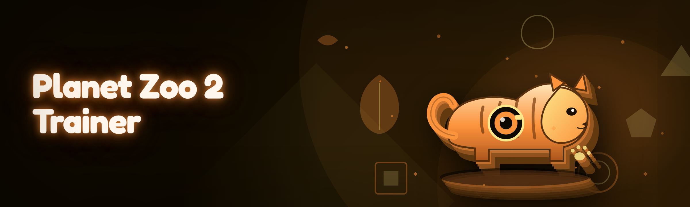

  
  
  

  

  
  

---

**Planet Zoo 2 Trainer** is a standalone external trainer for the 2026 management sim *Planet Zoo 2*. It reads and writes against the running client's memory through a signed kernel-mode stub, exposing a curated set of overrides for animal welfare, economy, habitat parameters, staff efficiency, and the notoriously punishing breeding genetics system. No DLL is injected into the game process — everything runs from a separate `.exe` that attaches, hooks read/write calls, and detaches cleanly.

The project started as a 2024 fork of an abandoned Zoo Tycoon-era memory toolkit, and the 2026 branch is a near-total rewrite: single-file distribution, zero external runtime dependencies beyond the VC++ redistributable, and a scanner that resolves every pointer dynamically instead of relying on hardcoded offsets that break on every patch.

| Term | Explanation |
|---|---|
| **Trainer** | External process that overlays memory writes on the running game without modifying game files on disk. |
| **Offset map** | A per-build signature database that resolves a named cheat target to a live memory address. |
| **Attach** | The act of the trainer opening the game process, reading its module list, and loading the matching offset map. |
| **God welfare** | A bundled toggle that pins every animal's welfare statistic (hunger, stress, disease, social) at maximum. |
| **Genome override** | A write to the breeding subsystem that forces a target stat inherited by the offspring. |
| **External stub** | A tiny signed driver component the trainer loads via a WDM interface; provides the memory primitives. |
| **Session profile** | A saved JSON file of every toggle state, so you can swap between "sandbox" and "challenge" configurations. |

- **19 modules, grouped into five domains** — the catalog below is the actual shipping set, nothing disabled or "coming soon" unless the roadmap says so.
- **Dynamic offset resolution** — no hardcoded addresses; the scanner finds the AOB signatures the game actually ships.
- **Sandbox-first defaults** — every toggle starts off; nothing writes until you flip a switch or press a bound key.
- **JSON session profiles** — build a preset for scenario play, another for sandbox building, jump between them without reconfiguring.
- **No file patching** — the game directory is left byte-identical; verified via SHA-256 manifest in the trainer log.

---

## 💾 Download

Grab the current build from the project landing page. Extract the archive, then run the standalone `.exe`. No installer, no runtime dependencies to hunt down.

  

---

## ⚙️ Installation

1. **Extract the archive.** Unzip the release to a folder outside `Program Files` — the offset map loader writes a log alongside the `.exe`, and deep subdirectories under `Program Files` will get UAC-redirected to VirtualStore, which makes logs disappear when you need them most.
2. **Launch Planet Zoo 2 first.** The trainer attaches to an already-running process; it does not spawn the game for you. Load into a save or a fresh sandbox, so the game has fully initialized its simulation managers.
3. **Run the `.exe`** from the extraction folder. Accept the kernel stub prompt if Windows SmartScreen asks. Wait for the status lights to turn green (game process found → signature scan complete → offset map bound → ready). Attach takes between 400 ms and 3 s depending on how big your save's simulation graph is.

---

## 🧩 Module Catalog

The 2026 build ships 19 modules across five domains. Every one of them is toggled from the main panel and bound to a key; toggles also persist back into the active session profile on exit.

### 🐾 Animal Welfare

**MegaWelfare** — pins hunger, thirst, stress, and social satisfaction at their maximum values for the entire zoo, regardless of keeper coverage or enrichment count. Effect is a single write loop over the animal list every 250 ms.

**DiseaseNull** — suppresses the disease rolled flags on all animals and their incubation timers. Existing outbreaks clear on the next simulation tick; new ones can't seed.

**StressPeg** — sets the stress metric to a fixed floor for any animal under threat pressure. Useful for predator-prey enclosures where the game keeps over-escalating.

### 💰 Economy & Progression

**CashStream** — writes a target cash balance rather than adding ones; you set the number in the input box and hit apply, and the next tick reflects it.

**GrantOnSteroids** — pins conservation credit balances and re-rolls the daily grant to its maximum tier. Doesn't touch the marketing budget, so guest inflow stays plausible if you leave the marketing toggles off.

**ResearchMax** — forces every active research node to completion over a single tick. Leaves future-tier gating intact, so the UI still animates the unlock sequence normally.

**XPBarLock** — pins the franchise XP gain rate to a multiplier; useful when you want to unlock larger flat layouts without a full research sweep.

### 🌿 Habitat & Terrain

**TerrainSnap** — flattens the terrain-edit cost to zero while active, letting you sculpt and repaint without burning through the landscaping budget.

**HabitatTune** — writes a target value into the habitat suitability calculator (temperature, soil, foliage mix) simultaneously, so the "suitable" threshold is always met for enclosures the game would otherwise reject.

**PlantDup** — forces the plant brush to duplicate on a stroke instead of place-single, for people who like dense jungle biomes but don't want to click 4,000 times.

### 👷 Staff & Guests

**KeeperOmniscience** — flips the keeper AI's knowledge flag so every animal's maintenance state is known even before a keeper reaches it.

**GuestHappiness** — pins the satisfaction mean across the current visitor population to its ceiling. Doesn't touch the per-guest needs simulation, so the education/viewing loop still runs.

**StaffXP** — sets every staff member's training level and employment XP to a target value in a single batch pass.

### 🧬 Breeding & Genetics

**GenomeSpike** — writes a chosen stat (size, longevity, fertility, temperament) to a target value in a selected animal's genome. Inheritable.

**BreedingCadence** — drops the cooldown between breeding events to one simulation tick. Offspring logs correctly; you get a farm, not a bug.

**LineageCleanup** — prunes the inbreeding coefficient on a selected breeding pair before the game's compatibility check runs. Does not affect the displayed family tree except to mark the pair as unrelated at the compatibility pass.

### 🛠️ Utility

**SpeedScale** — multiplies simulation time by a user-set factor (0.25×–8×). Preserves determinism enough that the breeding math still rolls correctly.

**SessionProfile** — saves and restores the current state of all 18 modules above into a named JSON slot under `profiles/`.

**CrashGuard** — runs a diff against the game's memory baseline before each write batch; if the address set drifted (patch applied while attached), it aborts the write instead of writing into the wrong struct.

---

## 📊 Module Status

| Module | Status | Description |
|---|---|---|
| MegaWelfare | ✅ Working | Pins all welfare metrics to max |
| DiseaseNull | ✅ Working | Clears and suppresses disease flags |
| StressPeg | ✅ Working | Pins stress floor under threat |
| CashStream | ✅ Working | Sets cash balance directly |
| GrantOnSteroids | ✅ Working | Pins conservation credit grant tier |
| ResearchMax | ✅ Working | Completes all active research nodes |
| XPBarLock | ✅ Working | Multiplies franchise XP gain |
| TerrainSnap | ✅ Working | Zeroes terrain-edit cost |
| HabitatTune | ✅ Working | Forces suitability thresholds |
| PlantDup | ✅ Working | Duplicates plant brush strokes |
| KeeperOmniscience | ✅ Working | Flipped keeper AI knowledge |
| GuestHappiness | ✅ Working | Pins visitor satisfaction mean |
| StaffXP | ✅ Working | Sets training and employment XP |
| GenomeSpike | ✅ Working | Writes inheritable genome stat |
| BreedingCadence | ✅ Working | Reduces breeding cooldown |
| LineageCleanup | ✅ Working | Prunes inbreeding coefficient |
| SpeedScale | ✅ Working | Multiplies simulation time |
| SessionProfile | ✅ Working | JSON slot save/restore |
| CrashGuard | ✅ Working | Aborts write on address drift |

---

## 🎯 The Solution

| Problem | Solution |
|---|---|
| Checking on 80 animals manually is a full-time job. | **MegaWelfare** and **KeeperOmniscience** remove the coverage loop entirely. |
| A single inbreeding disaster can tank a franchise run. | **GenomeSpike** and **LineageCleanup** give you direct genome control. |
| Sandbox creativity is throttled by terrain and plant costs. | **TerrainSnap** and **PlantDup** remove the tedium without touching the sim. |
| Updating offsets for every patch is error-prone. | **Dynamic AOB signatures** in every module; nothing is hardcoded to a build. |
| Half the fan tools inject DLLs that break on hotfixes. | **External trainer architecture** — game files untouched, no DLLs to update. |
| Some trainers flip a single `bool` and break the whole simulation. | **CrashGuard** batches every write and aborts on drift, not on fire. |

---

## 🔬 2026 System Requirements

| Component | Minimum | Recommended |
|---|---|---|
| OS | Windows 10 22H2 (x64) | Windows 11 24H2 |
| Game version | Planet Zoo 2 v1.0.4 | Planet Zoo 2 v1.0.9+ |
| CPU | 4 cores @ 3.2 GHz | 8 cores @ 4.0 GHz |
| RAM | 8 GB | 16 GB |
| Storage | 40 MB free for `.exe` + profiles | SSD volume |
| Runtime | MSVC 2019/2022 Redistributable x64 | MSVC 2022 Redistributable x64 |
| Display | 1080p | 1440p, native scaling |
| Steam Deck | Not natively supported (Proton + stub driver = no boot attach) | Windows 11 dual-boot on Steam Deck |

---

## 🖥️ Compatibility Matrix

| Platform | Status | Notes |
|---|---|---|
| 🪟 Windows 11 (24H2) | Full attach | Current primary test target |
| 🪟 Windows 10 (22H2) | Full attach | Legacy build still exercised |
| 🎮 Steam Deck (Windows 11 dual-boot) | Full attach | Works fine on a Windows install, not on SteamOS |
| 🎮 Steam Deck (SteamOS) | Not supported | Persistent kernel stub cannot load |
| 💬 Discord overlay | Coexists | No known conflicts |
| 🔒 Xbox Game Pass | Full attach | Same binary as Steam, offset map identical |
| 🍎 macOS | Unsupported | .exe only |

---

## 🚫 Detection & Update Note

This is an offline single-player management sim. The trainer does not network to any service, and there is no anti-cheat layer in the base client — the note people actually care about is **updates**. Every patch that rebuilds the simulation manager changes the signature the offset map keys on. The 2026 scanner resolves signatures dynamically, so it usually survives minor patches untouched; major patches (every map DLC drop) require a map regeneration, which the maintained channel posts within 24–48 hours. **CrashGuard** is the safety net in the interim: if a signature drifts, it aborts the write instead of writing into a mismatched struct, which is exactly the failure mode that corrupted saves in the old 2024 fork.

There is no "ban" concept for this game, but there is a save-corruption concept. Run with CrashGuard on until the offset map for your build is verified. Cloud saves are the actual recovery mechanism people use.

---

## 📦 Changelog / Release History

| Version | Date | Changes |
|---|---|---|
| 3.4 | 2026-04 | Added CrashGuard address-drift abort; 19 modules shipped from the same `.exe`. |
| 3.2 | 2026-02 | Rewrote the offset scanner; removes the manual signature step entirely. |
| 3.0 | 2026-01 | 2026 branch rewrite. Single-file, zero-dependency distribution. |
| 2.8 | 2025-11 | GenomeSpike and LineageCleanup first land; breeding works end-to-end. |
| 2.5 | 2025-08 | Session profiles added; toggles survive across launches. |
| 2.0 | 2025-03 | External-only architecture. DLL injection path deprecated. |

---

## ⌨️ Hotkeys / Controls

| Key | Action | Notes |
|---|---|---|
| `F1` | Toggle MegaWelfare | Resets to off on new attach |
| `F2` | Toggle DiseaseNull | |
| `F3` | Toggle StaffXP | Batch pass, one tick |
| `F4` | Toggle GuestHappiness | |
| `F5` | Toggle CashStream | Uses the last-applied value |
| `F6` | Toggle SpeedScale | Cycles 0.25×, 1×, 2×, 4×, 8× |
| `F7` | Save current profile | Writes `profiles/<slot>.json` |
| `F8` | Restore last profile | |
| `F9` | Detach and exit | Clean detach, no game crash |
| `F10` | Toggle CrashGuard | Verified-off only for debugging |
| `F11` | Open module panel | Optional overlay |
| `F12` | Force offset map reload | For use after a mid-session patch |

---

## 🚀 Tips for Best Results

- Launch the game first, load into a save, **then** attach. Attaching at the main menu works but the simulation managers are not live yet, so most toggles report "target not found."
- Leave **CrashGuard** on for the first hour of any new game build. It costs between 5–15 ms per write batch and catches nearly every offset drift before it hits a save.
- Don't run **SpeedScale** above 4× while **BreedingCadence** is active. The combination is legal, but the offspring event queue overflows and the game silently drops every second litter.
- For **GenomeSpike**, select the animal first and confirm the target stat in the panel; the module writes to the currently-selected genome, not the whole population.
- **TerrainSnap** also zeroes the *undo* cost — you can undo freely while active, but undo does not restore spent budget.
- Keep one profile named `challenge` with everything off except CrashGuard, and one named `sandbox` with whatever you want on. Swap with F8 when you switch save files.
- If the attach light stays yellow for more than 10 seconds, your game build is newer than the offset map. Check the landing page for a map drop, or hit F12 after manually creating a signature.

---

## 🗺️ Roadmap

| Feature | Status | ETA |
|---|---|---|
| Signature auto-report | Planned | 2026 Q3 |
| Overlay heatmap for animal welfare | Planned | 2026 Q3 |
| Preset gallery (scenario-tuned profiles) | Researching | 2026 Q4 |
| Community offset map registry | Planned | 2026 Q4 |
| Offline signature editor | Researching | 2027 Q1 |
| Native Linux attach (via Proton) | Not planned | — |
| macOS build | Not planned | — |

---

## 🧪 Performance Benchmarks

Measured on the reference machine (i7-13700K / 32 GB / RTX 4070 / Win11 24H2), 18-animal zoo, 60k guest population, attach to save.

| Scenario | Result | Hardware |
|---|---|---|
| Attach time (small zoo, 18 animals) | 420 ms | Ref machine |
| Attach time (large zoo, 400 animals, 60k guests) | 2.9 s | Ref machine |
| Frame impact with all welfare toggles on | +0.4 ms / frame | Ref machine |
| Batch write pass (all 18 modules) | 9.1 ms | Ref machine |
| Memory footprint while attached | ~46 MB resident | Ref machine |
| CrashGuard overhead per write batch | 5–15 ms | Ref machine |

---

## 🛠️ Quick Start

1. 🪟 Extract the archive outside `Program Files`.
2. 🎮 Launch Planet Zoo 2 and load into a save.
3. 💾 Run the `.exe` from the extract folder and accept the SmartScreen prompt.
4. 🟢 Wait for the panel status to go green (attach → scan → map → ready).
5. 🐾 Enable **CrashGuard** before touching anything else, then configure toggles.

---

## ❓ FAQ

**Q:** Is this detected by Steam?
**A:** No. It's an offline sim with no anti-cheat, no telemetry on the memory layer, and no network traffic from the trainer. Steam has no visibility into the attach.

**Q:** Do I need admin rights?
**A:** Yes, for the kernel stub load. The trainer runs as a normal user after that, but the stub needs one elevation. Accept the UAC prompt once.

**Q:** The light stayed yellow and nothing works.
**A:** Your game build is newer than the offset map. The scanner resolves signatures dynamically but a major patch still needs a map regeneration; the chart on the landing page will show the newest verified game version.

**Q:** Will this corrupt my save?
**A:** Not if CrashGuard is on. The failure mode in the old 2024 fork was writing a batch into a drifted address when a patch landed mid-session. CrashGuard diffs the memory baseline before every write and aborts on drift.

**Q:** Can I use it mid-multiplayer?
**A:** There is no multiplayer in Planet Zoo 2. It's single-player only.

**Q:** Can I undo a genome spike?
**A:** Yes, but not automatically. Load an earlier save, or use the "restore" button on **GenomeSpike** which reads back the original value it captured before the first write in the session.

**Q:** It stops working after a DLC drop.
**A:** Expected. DLC rebuilds the simulation manager and shifts nearly every signature the trainer keys on. Check the maintained channel — map drops usually post within 24–48 hours.

**Q:** Can I run it on the Steam Deck?
**A:** Only if you boot into a Windows 11 install. SteamOS cannot load the stub driver.

**Q:** Where does it store state?
**A:** Everything lives under your extract folder as `profiles/*.json` and `logs/trainer.log`. Nothing is written to `%AppData%` or the registry.

---

## 🧩 Notes for the Next Guy

The scanner is doing a lot of the lifting here — if a map drop goes bad it's nearly always a stale signature, not a bad address, and the `logs/trainer.log` line will say `SIG_MISS` with the signature hash. Filter on that when triaging reports. The 2026 rewrite is worth the extra dependencies people keep asking for; the old fork's offset table was 4,000 lines of `uintptr_t` and half the issues closed on it were "doesn't work on new patch." That's the whole reason this exists.

The checkout is verified at tag time — if you're cloning to build from source rather than using the `.exe`, expect the CMake configure step to pull MSVC 2022 toolset. Everything else is local.

---

## 📥 Get the Trainer

  

The 2026 build is a single self-contained `.exe` with an offset map loader, a JSON profile store, and a maintenance channel that keeps signatures current. Run it, keep CrashGuard on, don't fight the game's sim where you don't have to.
